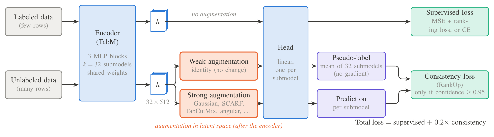

# Weak/strong augmentation in the latent space for RankUp on tabular data

In RankUp, the weak and strong views are usually made by perturbing the **input data**. Here the perturbation is moved to the **latent space**, the output of the TabM backbone, and compared with input-level augmentation on three tabular datasets (ordinal, classification, regression) with 1%, 10%, and 30% labeled data.



## Results at a glance

945 runs (3 datasets × 3 label percentages × 3 seeds, many configurations). Full numbers are in [`hasil/ringkasan.md`](hasil/ringkasan.md), and the discussion is in [`dokumen/PLAN_EKSPERIMEN_LATENT.md`](dokumen/PLAN_EKSPERIMEN_LATENT.md) section 5.

- RankUp helps mainly when labeled data is very scarce (1% labels).
- Input-level augmentation tends to fall below RankUp without augmentation, while latent-level augmentation is neutral or slightly above it. An added benefit is not proven, and the gap between operators is smaller than the standard deviation across seeds.
- Angular augmentation with controlled cosine (the supervisor's idea) is on par with the other latent operators.
- Limitations: 3 seeds, one data split, and the augmentation strength is not tuned.

## Folder structure

```
.
├── kode/              experiment code
│   ├── latent.py          latent operators, hook on the TabM backbone, run_one
│   ├── grid.py            all configurations and their groups
│   ├── modal_latent.py    runs the grid on Modal (T4 GPU)
│   ├── ringkas.py         builds hasil/ringkasan.md
│   ├── test_latent.py     unit tests
│   ├── visualisasi.ipynb  result plots
│   └── experiments/       RankUp training loop (copied unchanged from `../4-augmentasi-input/eksperimen/experiments/`)
├── data/              data splits (npz + manifest): label_01, label_10, label_30
├── hasil/             results.jsonl (one line per run), ringkasan.md, pembanding/
├── gambar/            diagrams (LaTeX, PDF + PNG); see gambar/README.md
└── dokumen/           plan and meeting notes
    ├── PLAN_EKSPERIMEN_LATENT.md
    └── rapat/             notes on the supervisor's ideas (13 November)
```

Meeting recordings, the AI context package, and run logs are kept only locally (in `../arsip/`) and are not uploaded. The reference papers (PDFs, sources, and reviews) are in [`../referensi/`](../referensi/).

## Flow

```
x_u (unlabeled) ──► input augmentation? ──► TabM backbone ──► h (B × 32 × 512) ──► latent augmentation? ──► head
                    (old operators)                                               (hook, weak/strong
                                                                                   views in training only)
weak view   → prediction becomes the pseudo-label (ranking for ordinal/regression, class for classification)
strong view → trained to follow the pseudo-label (RankUp consistency loss)
```

Labeled data, validation, and test are never perturbed. The new code only (1) replaces the `augment` function and (2) attaches a hook on the backbone output, so the `input_*` configurations give results identical to the earlier experiment.

## Getting started

Requires Python 3.10 or newer.

```bash
python -m venv .venv && source .venv/bin/activate
pip install -r requirements.txt
cd kode

PYTHONPATH=. python test_latent.py -v     # unit tests (CPU)
python ringkas.py                         # builds ../hasil/ringkasan.md from results.jsonl
jupyter lab visualisasi.ipynb             # plots; run all cells
```

Run experiments on Modal (needs a Modal account; replace `<profile>` or remove `MODAL_PROFILE`):

```bash
MODAL_PROFILE=<profile> modal run modal_latent.py                                  # tests + 2-epoch smoke run
MODAL_PROFILE=<profile> modal run modal_latent.py --action run --names fase1       # one group
MODAL_PROFILE=<profile> modal run modal_latent.py --action run --names angular --seeds 42 --percents 10
```

Runs already in `hasil/results.jsonl` are skipped, so the same command is safe to repeat if it gets interrupted. For a long grid, run it as a service (for example `systemd-run --user`) so it does not die when the terminal is closed.

## Configuration names

Format `{position}_{operator}[_weak]`; operators: `gaussian`, `zero_out`, `scarf`, `tabcutmix`.

| Position | Meaning |
|---|---|
| `supervised` | No RankUp (unlabeled weight 0) |
| `rankup_noaug` | RankUp with no augmentation at all (control) |
| `input_` | Augmentation at the input |
| `latent_` | Augmentation in the latent space; weak = identity |
| `latent_…_weak` | Augmentation in the latent space; weak is also lightly perturbed (0.1) |
| `both_` | Strong view augmented at the input and then in the latent space |
| `angular`, `angular_weak` | Controlled cosine: strong cos ∈ [0.3, 0.5], weak cos ∈ [0.7, 0.95] |
| `angular[_weak\|_weak90][_s10\|_s50]` | Ablation of the cosine range |
| `angular…_prerelu` | Rotation before the last block's ReLU, instead of at the backbone output |
| `matched_{op}` | Old operator with the strength that gives cos ≈ 0.4, the same as `angular` |
| `advrot_{05\|10\|20}` | Head-aware adversarial rotation, angular distance d ≈ 0.05/0.10/0.20 (θ = π·d); see [`dokumen/USULAN_ROTASI_ADVERSARIAL.md`](dokumen/USULAN_ROTASI_ADVERSARIAL.md) |
| `headrot_{10\|20}` | Control: same head-aware rotation with a random sign (not adversarial) |

## Data

Three public datasets: NHANES (ordinal, QWK metric), Pen Digits (classification, Macro F1), and Superconductivity (regression, MSE). `data/` holds the ready-made splits (labeled, unlabeled, validation, and test; split seed 42), only the `.npz` files and `manifest.json`.
