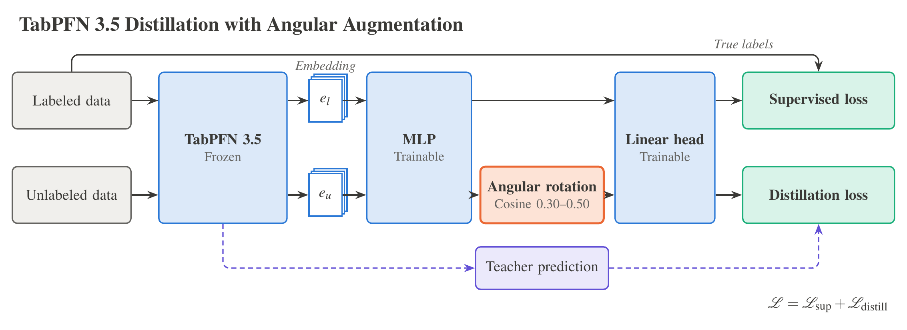

# Eksperimen SSL dan augmentasi pada data tabular

Penelitian ini menguji dua pertanyaan. **Apakah data tanpa label meningkatkan akurasi saat label terbatas?** Setelah metode SSL ditetapkan, **apakah augmentasi memberi peningkatan tambahan?** Fokus perbandingan saat ini adalah SSR-RCUS dengan TabM dan dua pembanding TabPFN 3.5. Eksperimen ICS yang sudah selesai tetap tersedia dalam laporan Kaggle terpisah.

[Grafik dan skor SSR-RCUS](../output/perbandingan_ssr_rcus.md) · [Perbandingan lintas metode](../output/perbandingan_metode_ssl.md) · [Notebook Kaggle](../kaggle_tabpfn_konteks.ipynb)

## Alur eksperimen

| Tahap | Pertanyaan yang diuji |
|---|---|
| [1–2 · RankUp awal dan ordinal](../../2-rankup-ordinal/README.md) | Apakah RankUp membantu regresi dan ordinal pada beberapa backbone serta proporsi label? |
| [3 · Pembanding SSL](../../3-pembanding-ssl/README.md) | Bagaimana RankUp dan RankUp-CLS dibandingkan dengan SSLAE, VIME, STUNT, dan GFTab? |
| [4 · Augmentasi fitur](../../4-augmentasi-input/RINGKASAN_SEMUA_EKSPERIMEN.md) | Apa efek operator augmentasi pada fitur tabular? |
| [5 · RankUp dan latent TabM](../../5-augmentasi-latent/README.md) | Apa efek memindahkan augmentasi ke representasi TabM atau menerapkannya pada kedua posisi? |
| [6 · SSR-RCUS](../../6-ssr-rcus/README.md) | Apa efek menambahkan angular di latent TabM dan operator augmentasi terdahulu pada pipeline SSR-RCUS? |
| [7 · Embedding TabPFN](../../7-tabpfn-latent/README.md) | Apakah MLP yang menerima embedding TabPFN dapat memanfaatkan data tanpa label melalui distilasi? |
| [8 · Distilasi, EMA, dan konteks](../README.md) | Bagaimana distilasi dan self-training EMA dibandingkan saat memakai embedding asli, augmentasi latent, atau konteks yang disubsampel? |

## Data dan protokol

| Dataset | Tugas | Train pool | Label pada 1% / 10% / 30% | Validasi | Test | Metrik utama di laporan lintas tahap |
|---|---|---:|---:|---:|---:|---|
| NHANES | Ordinal, 5 level | 3.655 | 36 / 365 / 1.096 | 784 | 784 | QWK mentah ↑ |
| Pen Digits | Klasifikasi, 10 kelas | 5.995 | 59 / 599 / 1.798 | 1.499 | 3.498 | Macro-F1 ↑ |
| Superconductivity | Regresi suhu kritis | 15.006 | 150 / 1.500 / 4.501 | 3.176 | 3.081 | MSE ↓ |

Ketiga fraksi label memakai **seed 42, 123, dan 456** dengan split validasi dan test yang tetap. Persentase label dihitung dari train pool. Sisa baris train tersedia sebagai data tanpa label. Dalam eksperimen TabPFN tahap 8, semua varian SSL pada satu kondisi memakai pool yang sama, maksimal 5.000 baris.

**Validasi** dipakai untuk memilih checkpoint dan membandingkan metode. **Test** mengukur metode dari checkpoint terpilih. Laporan utama membandingkan rerata validasi tiga seed dan menampilkan simpangan baku. Untuk NHANES, tahap 8 memilih checkpoint dengan **QWK terkalibrasi** menggunakan batas kelas dari validasi. Laporan lintas tahap memakai **QWK mentah** agar cara menghitung skor yang ditampilkan konsisten. Pemilihan checkpoint masih mengikuti protokol tiap tahap.

## Empat kelompok dalam laporan utama

| # | Kelompok | Apa yang dijalankan |
|---|---|---|
| 1 | **SSR-RCUS + TabM** | Weak dan strong memakai baris asli. Manifold mixup SSR-RCUS tetap aktif. |
| 2 | **SSR-RCUS + angular** | Baseline yang sama dengan rotasi di latent TabM. Varian strong memakai cosine 0,30–0,50. Varian weak + strong juga memutar weak dengan cosine 0,70–0,95. |
| 3 | **SSR-RCUS + augmentasi sebelumnya** | Gaussian, Zero-out, dan SCARF, masing-masing pada strong dengan strength 0,5. Skor yang tersedia berasal dari run yang menerapkan operator pada fitur asli sebelum TabM. |
| 4 | **TabPFN 3.5** | Prediksi langsung sebagai kontrol dan MLP dengan distilasi serta angular di latent sebagai varian SSL. |

Pada Pen Digits, kelompok 1–3 menggunakan SSR-RCUS-CLS, adaptasi klasifikasi yang memakai mixup target kelas. Untuk mengukur efek operator pada SSR-RCUS, bandingkan kelompok 2 dan 3 dengan kelompok 1. Untuk mengukur efek angular pada distilasi, bandingkan `head_angular` dan `head_distill` dari tahap 8. Perbandingan SSR-RCUS dengan TabPFN juga mencakup perbedaan backbone, loss, serta aturan pemilihan checkpoint. [Konfigurasi SSR-RCUS](../../6-ssr-rcus/README.md)

## Cara kerja TabPFN 3.5 + distilasi + angular

1. **Ekstraksi embedding.** TabPFN memakai konteks dari train berlabel. Untuk setiap fold data train berlabel, konteks berasal dari empat fold lain. Untuk train tanpa label, validasi, dan test, konteks memakai semua baris train berlabel. Embedding per baris dirata-ratakan dari anggota ensemble.
2. **Jalur berlabel.** MLP dengan dua lapisan tersembunyi berukuran 256 menerima embedding dan mempelajari label asli. Loss-nya cross-entropy untuk klasifikasi dan MSE untuk ordinal serta regresi.
3. **Jalur tanpa label.** TabPFN menghasilkan target untuk baris asli berupa probabilitas kelas atau prediksi kontinu. MLP memproses embedding baris yang sama. Setelah lapisan tersembunyi terakhir, angular memutar vektor MLP dengan cosine yang disampel dari 0,30–0,50. Head belajar mengikuti target guru dengan soft cross-entropy atau MSE.
4. **Pembaruan bobot.** AdamW memperbarui MLP dan head dengan jumlah kedua loss. Bobot TabPFN dibekukan. Saat evaluasi, student tetap menerima embedding TabPFN. Rotasi dan dropout dinonaktifkan.

Varian di laporan bernama `head_angular` pada tahap 8. Prediksi langsung bernama `tabpfn`. Kode juga memiliki `head_sup` untuk MLP berlabel saja, `head_distill` untuk distilasi tanpa augmentasi, dan `head_match` untuk self-training EMA. Varian yang sudah dijalankan memakai objective tersebut. Kombinasi TabPFN + RankUp adalah rancangan lanjutan.

[Diagram detail versi Inggris](../gambar/arsitektur/tabpfn_distillation_angular_detail_en.pdf) · [Kode training](../tabpfn_konteks.py) · [Kode rotasi angular](../stage8_common.py)

## Hasil dan cara membacanya

Rerata validasi di bawah memakai run tahap 8. Tabel memasangkan baseline MLP, distilasi tanpa augmentasi, dan distilasi angular dari pipeline yang sama. TabPFN langsung menjadi pembanding tambahan.

| Dataset | Label | TabPFN langsung | MLP supervised | Distilasi | Distilasi + angular |
|---|---:|---:|---:|---:|---:|
| NHANES · QWK ↑ | 1% | 0,0886 | 0,0661 | 0,0760 | **0,2216** |
| NHANES · QWK ↑ | 10% | 0,2382 | 0,1376 | 0,2262 | **0,3135** |
| NHANES · QWK ↑ | 30% | 0,3391 | 0,2857 | 0,3034 | **0,4088** |
| Pen Digits · Macro-F1 ↑ | 1% | 0,9092 | 0,8833 | 0,9123 | **0,9134** |
| Pen Digits · Macro-F1 ↑ | 10% | 0,9887 | 0,9881 | **0,9903** | 0,9897 |
| Pen Digits · Macro-F1 ↑ | 30% | 0,9971 | 0,9969 | 0,9978 | 0,9978 |
| Superconductivity · MSE ↓ | 1% | 288,07 | 306,06 | **280,84** | 402,74 |
| Superconductivity · MSE ↓ | 10% | **150,03** | 152,06 | 150,11 | 174,17 |
| Superconductivity · MSE ↓ | 30% | 105,58 | 106,90 | **105,14** | 137,54 |

- **Bukti manfaat data tanpa label.** Distilasi tanpa augmentasi memberi rerata lebih baik daripada MLP supervised di 9 dari 9 kondisi pada metrik tabel. Perbandingan ini memakai ekstraktor yang sama. Tiga seed pada satu split memberi bukti deskriptif.
- **Efek angular bergantung pada tugas.** Pada NHANES, QWK mentah naik di ketiga fraksi label, tetapi QWK terkalibrasi hanya berubah **+0,0017 / −0,0009 / +0,0052** dibanding distilasi tanpa augmentasi. Pada Pen Digits, perubahan kecil. Pada Superconductivity, angular menaikkan MSE pada ketiga fraksi label.
- **SSR-RCUS.** Angular strong mengungguli baseline pada 4 dari 9 kondisi. Pada Pen Digits 1%, SSR-RCUS + Zero-out mendapat Macro-F1 **0,9419**. Pada 10%, baseline SSR-RCUS-CLS mendapat **0,9907**.
- **Pembanding TabPFN.** Di laporan empat kelompok, distilasi + angular mengungguli semua varian SSR-RCUS pada 7 dari 9 kondisi. TabPFN langsung memberi MSE lebih rendah daripada angular pada ketiga fraksi label Superconductivity. **Pemenang bergantung pada dataset dan fraksi label.**

[Skor per run](../output/hasil_tabpfn_konteks/full/skor_per_run.csv) · [Validasi dan test metode terpilih](../output/hasil_tabpfn_konteks/full/pilihan_validation.csv) · [Tabel dan grafik SSR-RCUS](../output/perbandingan_ssr_rcus.md)

## Riwayat Kaggle dan reproduksi

Tahap 8 selesai dengan **45 run smoke** dan **468 run penuh**, terdiri dari 405 run inti dan 63 run ablasi konteks. Padanan baseline, latent, EMA, dan ICS dijalankan dalam pipeline yang sama. Hasil ICS tersedia di laporan Kaggle dan dikeluarkan dari grafik fokus saat ini, bersama Optuna dan TabPFN 2.5.

Untuk mengulang, impor [notebook Kaggle](../kaggle_tabpfn_konteks.ipynb), pasang dataset split tahap 7, jalankan smoke, lalu grid penuh mengikuti [petunjuk Kaggle](../README.md#jalankan-di-kaggle). Skor, konfigurasi, dan ringkasan tiap run tersedia di [hasil penuh](../output/hasil_tabpfn_konteks/full/). Cache embedding, ZIP, serta prediksi dan diagnostik per baris disimpan lokal. Rekap statistik dan gambar yang dipakai oleh laporan tersedia di repositori.

## Eksperimen lanjutan

1. **SSR-RCUS + Gaussian, Zero-out, SCARF di latent TabM.** Jalankan tiap operator pada strong dengan strength 0,5 dan pipeline SSR-RCUS yang sama. Ini menambah **81 run**. Bandingkan dengan baseline, angular, dan skor operator yang sama sebelum TabM.
2. **TabPFN 3.5 + RankUp.** Pakai embedding TabPFN beku, latih MLP dengan objective RankUp atau RankUp-CLS, lalu uji matriks distilasi ya/tidak × angular ya/tidak. Pakai kontrol distilasi + angular dari pipeline MLP yang sama ketika mengukur kontribusi tambahan RankUp.
3. **Posisi augmentasi dan fine-tuning.** Bandingkan rotasi pada embedding keluaran TabPFN dan pada hidden MLP. Fine-tuning menjadi eksperimen terpisah setelah jalur ekstraksi dengan gradien tersedia.

[Rincian konfigurasi lanjutan](../output/perbandingan_ssr_rcus.md#catatan-eksperimen-lanjutan--belum-dijalankan)

## Referensi metode

- **Knowledge distillation:** Hinton, Vinyals, dan Dean (2015). [Distilling the Knowledge in a Neural Network](https://arxiv.org/abs/1503.02531)
- **Distilasi model tabular:** Prior Labs (2025) untuk contoh TabPFN ke MLP, dan Jeong dkk. (2026) untuk distilasi dengan konteks berlabel. [TabPFN-2.5](https://arxiv.org/abs/2511.08667) · [Distillation of Tabular Foundation Models into Efficient Predictors](https://arxiv.org/abs/2610.01435)
- **Ekstraktor yang dipakai:** Prior Labs (2026). [TabPFN-3.5: Technical Report](https://priorlabs.ai/technical-reports/tabpfn-3-5)
- **Rotasi fitur:** Kobayashi (ECCV 2022). [Rotation Regularization Without Rotation](https://www.ecva.net/papers/eccv_2022/papers_ECCV/html/7735_ECCV_2022_paper.php)
- **RankUp, SSR-RCUS, dan augmentasi tabular:** [Indeks referensi proyek](../../referensi/README.md).
