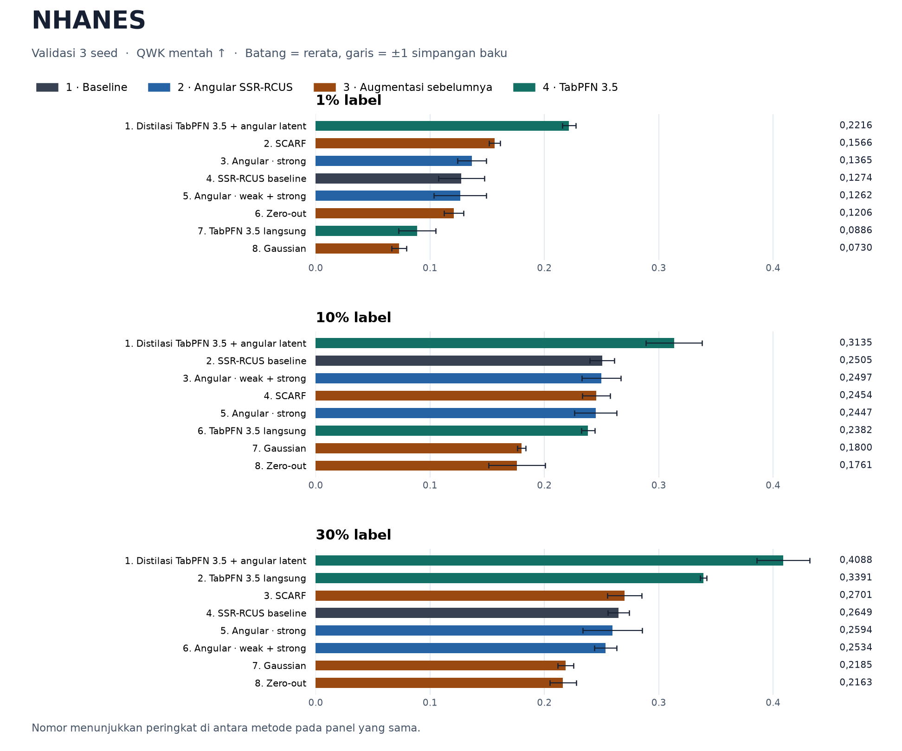
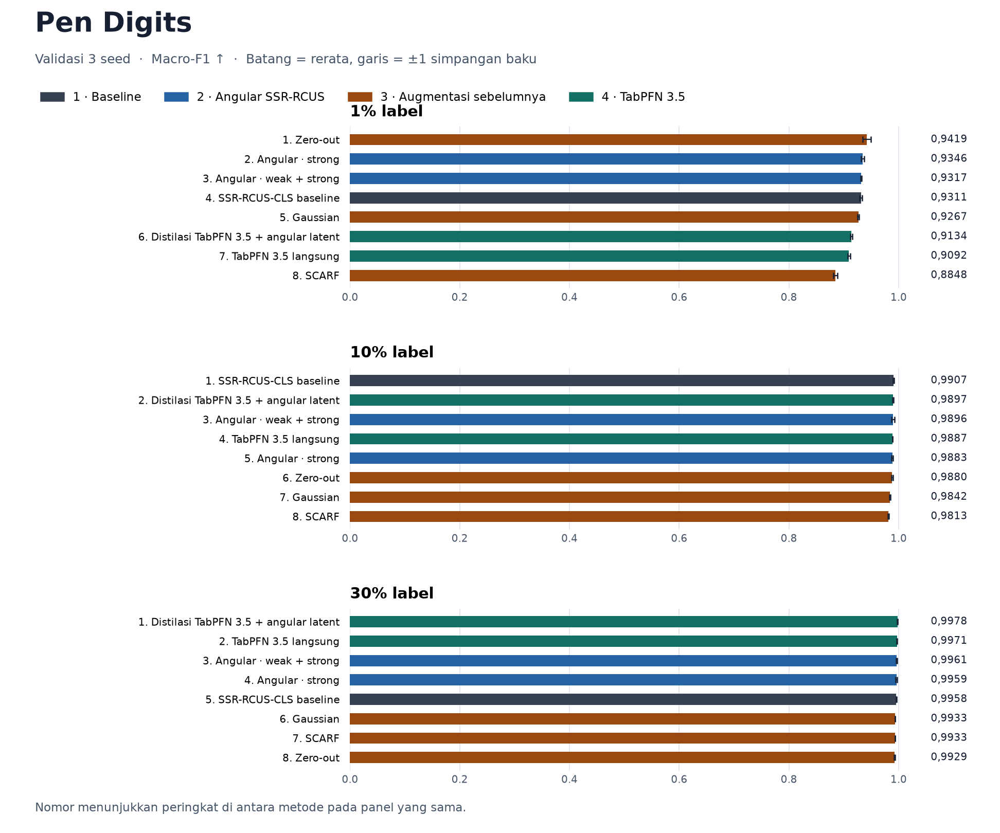
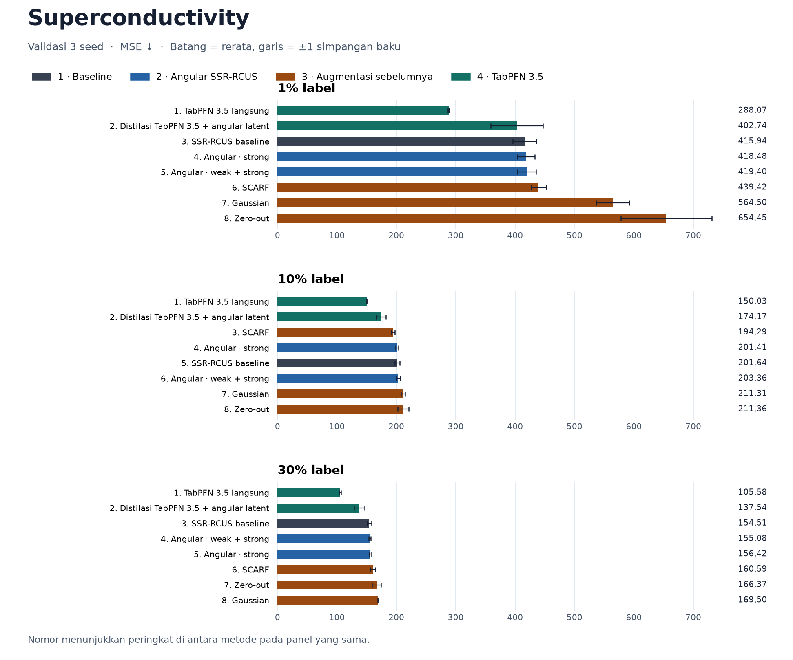
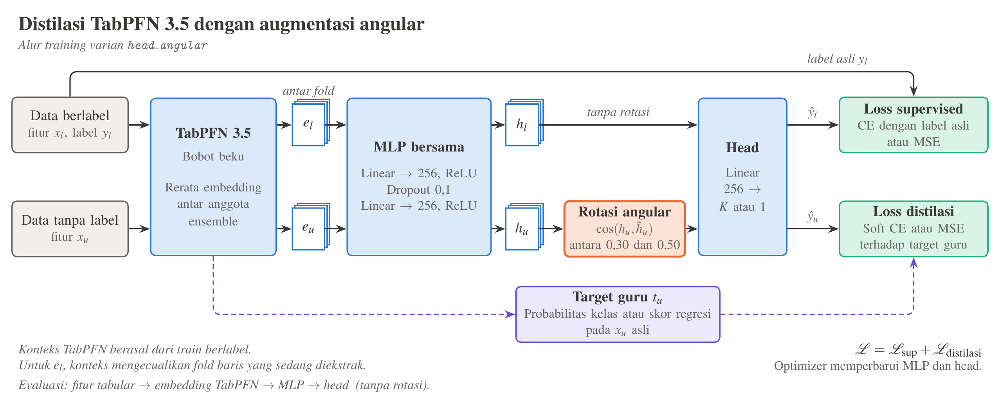

# Perbandingan SSR-RCUS pada data tabular

Hasil **validasi** dari seed **42, 123, dan 456**, dengan **1%, 10%, dan 30% label** pada NHANES, Pen Digits, dan Superconductivity.

## Empat kelompok eksperimen

| # | Kelompok | Konfigurasi |
|---|---|---|
| 1 | **SSR-RCUS baseline + TabM** | Pakai dataset dan split proyek dengan backbone TabM. View weak dan strong memakai baris asli. Manifold mixup bawaan SSR-RCUS tetap aktif. |
| 2 | **SSR-RCUS + angular (cosine)** | Pakai konfigurasi baseline dan tambah rotasi di latent TabM. Dua varian yang diuji: strong saja (cosine 0,30–0,50), serta weak (0,70–0,95) + strong (0,30–0,50). |
| 3 | **SSR-RCUS + augmentasi sebelumnya** | Gaussian, Zero-out, dan SCARF diuji satu per satu pada view strong, masing-masing dengan strength 0,5. |
| 4 | **Pembanding TabPFN 3.5** | **TabPFN langsung** membuat prediksi dari konteks berlabel. **Distilasi + angular latent** melatih MLP dari prediksi TabPFN dan menerapkan rotasi angular pada latent MLP. |

**Perbandingan utama** memakai konfigurasi SSR-RCUS + TabM yang sama untuk kelompok 1–3. Pada Pen Digits, SSR-RCUS dan RankUp memakai adaptasi klasifikasi. Untuk spesifikasi algoritme dan konfigurasi training, lihat [README SSR-RCUS](../../6-ssr-rcus/README.md).

Skor kelompok 3 berasal dari run yang menerapkan augmentasi pada fitur asli sebelum TabM. Angular pada kelompok 2 diterapkan pada representasi latent TabM. [Konfigurasi run SSR-RCUS](../../6-ssr-rcus/varian.py).

## Hasil validasi SSR-RCUS

Angka adalah **rerata ± simpangan baku** dari tiga seed. Tebal menandai rerata terbaik di antara konfigurasi SSR-RCUS yang sudah dijalankan pada setiap kondisi.

Setiap panel mengurutkan skor dari empat kelompok. Batang oranye menunjukkan Gaussian, Zero-out, dan SCARF.

### NHANES · QWK mentah ↑

| Kelompok | Metode | 1% label | 10% label | 30% label |
|---|---|---:|---:|---:|
| 1 | SSR-RCUS baseline | 0,1274 ± 0,0202 | **0,2505 ± 0,0107** | 0,2649 ± 0,0094 |
| 2 | Angular · strong | 0,1365 ± 0,0125 | 0,2447 ± 0,0183 | 0,2594 ± 0,0260 |
| 2 | Angular · weak + strong | 0,1262 ± 0,0227 | 0,2497 ± 0,0170 | 0,2534 ± 0,0096 |
| 3 | Gaussian | 0,0730 ± 0,0065 | 0,1800 ± 0,0037 | 0,2185 ± 0,0070 |
| 3 | Zero-out | 0,1206 ± 0,0085 | 0,1761 ± 0,0248 | 0,2163 ± 0,0114 |
| 3 | SCARF | **0,1566 ± 0,0049** | 0,2454 ± 0,0123 | **0,2701 ± 0,0151** |
| 4 | Distilasi TabPFN 3.5 + angular latent | 0,2216 ± 0,0058 | 0,3135 ± 0,0246 | 0,4088 ± 0,0232 |
| 4 | TabPFN 3.5 langsung | 0,0886 ± 0,0163 | 0,2382 ± 0,0058 | 0,3391 ± 0,0028 |

### Pen Digits · Macro-F1 ↑

| Kelompok | Metode | 1% label | 10% label | 30% label |
|---|---|---:|---:|---:|
| 1 | SSR-RCUS-CLS baseline | 0,9311 ± 0,0022 | **0,9907 ± 0,0007** | 0,9958 ± 0,0008 |
| 2 | Angular · strong | 0,9346 ± 0,0026 | 0,9883 ± 0,0017 | 0,9959 ± 0,0013 |
| 2 | Angular · weak + strong | 0,9317 ± 0,0008 | 0,9896 ± 0,0025 | **0,9961 ± 0,0011** |
| 3 | Gaussian | 0,9267 ± 0,0014 | 0,9842 ± 0,0010 | 0,9933 ± 0,0000 |
| 3 | Zero-out | **0,9419 ± 0,0073** | 0,9880 ± 0,0012 | 0,9929 ± 0,0010 |
| 3 | SCARF | 0,8848 ± 0,0038 | 0,9813 ± 0,0012 | 0,9933 ± 0,0000 |
| 4 | Distilasi TabPFN 3.5 + angular latent | 0,9134 ± 0,0019 | 0,9897 ± 0,0010 | 0,9978 ± 0,0004 |
| 4 | TabPFN 3.5 langsung | 0,9092 ± 0,0023 | 0,9887 ± 0,0000 | 0,9971 ± 0,0004 |

### Superconductivity · MSE ↓

| Kelompok | Metode | 1% label | 10% label | 30% label |
|---|---|---:|---:|---:|
| 1 | SSR-RCUS baseline | **415,94 ± 19,75** | 201,64 ± 3,92 | **154,51 ± 3,76** |
| 2 | Angular · strong | 418,48 ± 14,89 | 201,41 ± 2,40 | 156,42 ± 2,14 |
| 2 | Angular · weak + strong | 419,40 ± 15,61 | 203,36 ± 3,24 | 155,08 ± 1,80 |
| 3 | Gaussian | 564,50 ± 27,85 | 211,31 ± 3,20 | 169,50 ± 0,72 |
| 3 | Zero-out | 654,45 ± 76,71 | 211,36 ± 9,17 | 166,37 ± 7,49 |
| 3 | SCARF | 439,42 ± 12,69 | **194,29 ± 3,02** | 160,59 ± 3,98 |
| 4 | Distilasi TabPFN 3.5 + angular latent | 402,74 ± 44,03 | 174,17 ± 8,08 | 137,54 ± 8,82 |
| 4 | TabPFN 3.5 langsung | 288,07 ± 1,11 | 150,03 ± 0,10 | 105,58 ± 1,13 |

Angular strong memperbaiki rerata baseline di **4 dari 9 kondisi**, sedangkan angular weak + strong di **2 dari 9**. Hitungan ini membandingkan rerata tiga seed per kondisi.

## Pemilihan pembanding TabPFN 3.5

[Diagram ringkas versi Inggris](../gambar/arsitektur/tabpfn_distillation_angular_simple_en.pdf) · [Diagram detail versi Inggris](../gambar/arsitektur/tabpfn_distillation_angular_detail_en.pdf)

Distilasi + angular latent berbagi rerata peringkat terbaik (**21,44**) di antara varian TabPFN 3.5 dengan augmentasi yang dievaluasi. Pada grafik ini, varian TabPFN tersebut mengungguli semua varian SSR-RCUS di **7 dari 9 kondisi**. Dua pengecualian ada di **Pen Digits 1% dan 10% label**. TabPFN langsung memberi MSE lebih rendah daripada distilasi + angular pada ketiga persentase label Superconductivity. Distilasi + angular mendapat skor lebih tinggi pada ketiga persentase label di NHANES dan Pen Digits.

Sumber hasil: [run SSR-RCUS](../../6-ssr-rcus/hasil/results.jsonl) dan [rekap lintas eksperimen](peringkat_ssl_dan_augmentasi.csv). Ringkasan ini memakai varian dengan tiga seed yang sama dan mengecualikan ICS, Optuna, serta TabPFN 2.5.

## Catatan eksperimen lanjutan · belum dijalankan

### 1. SSR-RCUS + operator lama di latent TabM

Jalankan **Gaussian, Zero-out, dan SCARF** secara terpisah pada representasi *strong* di latent TabM, dengan strength **0,5** dan *weak view* tanpa augmentasi tambahan. Pertahankan pipeline SSR-RCUS yang sama, termasuk manifold mixup, split, dan aturan pemilihan checkpoint. Bandingkan hasil tiap operator dengan skor kelompok 3 di laporan ini untuk melihat efek memindahkan augmentasi ke latent, lalu dengan SSR-RCUS baseline dan angular.

**81 run** untuk tiga operator × tiga dataset × tiga persentase label × tiga seed. [Konfigurasi operator dari RankUp Latent](../../5-augmentasi-latent/kode/grid.py).

### 2. TabPFN 3.5 + RankUp dengan distilasi dan augmentasi latent

**Ekstraksi fitur.** TabPFN 3.5 menerima fitur tabular dan konteks dari data train berlabel. Ambil vektor per baris dengan `get_embeddings` dan rata-ratakan embedding dari anggota ensemble. Untuk baris train berlabel, ekstrak embedding per fold dengan konteks dari fold lain agar label baris itu sendiri tidak masuk konteks. Untuk train tanpa label, validasi, dan test, pakai konteks train berlabel. Simpan embedding per split dan seed untuk dipakai oleh semua varian. [Implementasi ekstraksi dan pembagian fold](../tabpfn_konteks.py).

**Training.** Bekukan bobot TabPFN dan latih **MLP serta head-nya** dari embedding tersebut. Pakai label asli untuk loss supervised. Pada data tanpa label, pakai loss RankUp dengan head regresi dan **ARC** (*auxiliary ranking classifier*) untuk NHANES dan Superconductivity, serta pseudo-label kelas **RankUp-CLS** untuk Pen Digits. Jika distilasi aktif, tambahkan loss agar prediksi MLP mengikuti prediksi TabPFN pada baris tanpa label yang sama. Jika augmentasi aktif, terapkan angular pada latent *strong view* MLP dengan cosine **0,30–0,50**.

| Varian | Loss distilasi TabPFN | Angular di latent MLP |
|---|---|---|
| RankUp + embedding TabPFN | Tidak | Tidak |
| RankUp + embedding TabPFN + angular | Tidak | Ya |
| RankUp + embedding TabPFN + distilasi | Ya | Tidak |
| RankUp + embedding TabPFN + distilasi + angular | Ya | Ya |

Pertahankan embedding, arsitektur MLP, dan konfigurasi RankUp yang sama di keempat varian. Tabel ini menguji kontribusi distilasi dan augmentasi secara terpisah. Gunakan **distilasi TabPFN 3.5 + angular latent** dari kelompok 4 sebagai pembanding untuk melihat apakah menambahkan RankUp memperbaiki hasil. [Implementasi distilasi yang sudah ada](../tabpfn_konteks.py).

### 3. Posisi augmentasi dan TabPFN yang ikut dilatih

| Perbandingan | Rancangan |
|---|---|
| **Latent TabPFN vs latent MLP** | Bandingkan angular pada embedding keluaran TabPFN sebelum masuk MLP dengan angular pada representasi tersembunyi setelah masuk MLP. Pakai konfigurasi RankUp, distilasi, dan rentang cosine yang sama. Terapkan angular pada satu posisi per run. |
| **Ekstraktor beku vs TabPFN yang ikut dilatih** | Pertahankan varian ekstraktor beku sebagai pembanding. Untuk varian fine-tuning, cek dulu apakah checkpoint dan jalur ekstraksi yang digunakan mendukung gradien. Jika tersedia, hitung embedding saat training dan perbarui bagian TabPFN yang dipilih bersama MLP. Jika distilasi aktif, gunakan salinan TabPFN beku sebagai teacher. |

Eksperimen lanjutan memakai **1%, 10%, dan 30% label**, **seed 42, 123, dan 456**, dan metrik validasi yang sama dengan laporan. Konteks TabPFN tetap tanpa ICS. Pilih checkpoint dari validasi, lalu evaluasi test setelah konfigurasi dipilih.
