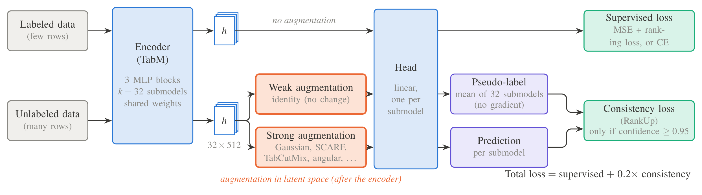

# Augmentasi untuk semi-supervised learning RankUp pada data tabular

Riset tugas akhir tentang cara membuat **view strong** dari data tanpa label pada **RankUp** (Huang dkk., NeurIPS 2024), dan apakah gangguan itu lebih baik diberikan di **data input** atau di **ruang latent** model. Eksperimen dijalankan pada tiga jenis tugas tabular (ordinal, klasifikasi, regresi) dengan data berlabel hanya 1%, 10%, dan 30%.



## Latar belakang

Label mahal, data tanpa label murah. **Semi-supervised learning (SSL)** memakai keduanya. Metode seperti FixMatch memilih pseudo-label dengan confidence threshold, tetapi ini tidak bisa dipakai pada regresi karena prediksi regresi tidak menunjukkan confidence. **RankUp** mengatasinya dengan *auxiliary ranking classifier* (ARC) yang menebak urutan dua sampel, dan hanya memakai tebakan dengan confidence tinggi.

```
Data berlabel   ──► model ──► loss supervised (MSE / cross-entropy) + loss ranking berlabel
Data tanpa label:
   view weak   (data asli)          ──► model ──► "kunci jawaban" (pseudo-label / urutan pasangan)
   view strong (data diaugmentasi)  ──► model ──► harus konsisten dengan kunci jawaban
Total loss = supervised + 0,2 × konsistensi   (hanya pasangan dengan confidence ≥ 0,95)
```

Augmentasi menentukan seberapa dan ke arah mana view strong berbeda dari aslinya, jadi augmentasi adalah variabel yang dibandingkan di riset ini.

**Pertanyaan riset**

1. Augmentasi mana yang paling baik untuk view strong pada data tabular, dan apakah jawabannya berbeda untuk tugas ordinal, klasifikasi, dan regresi?
2. Kalau gangguan weak/strong dipindah dari data input ke **ruang latent** (output backbone TabM), apakah hasilnya lebih baik?

## Ringkasan hasil

Angka lengkap ada di folder masing-masing tahap.

**Augmentasi di input** ([tahap 4](4-augmentasi-input/RINGKASAN_SEMUA_EKSPERIMEN.md)):

- Tidak ada satu augmentasi yang selalu terbaik. Pemenangnya berganti antar dataset, persentase label, dan antara validation dan test.
- RankUp umumnya lebih baik daripada tanpa RankUp, terutama saat label sedikit (tanpa Optuna, 1 seed, augmentasi terbaik: NHANES 1% QWK 0,150 → 0,251; Pen Digits 1% Macro F1 0,838 → 0,877).
- Variasi antar seed bisa sebesar atau lebih besar dari perbedaan antar augmentasi.
- Optuna tidak selalu membantu, dan banyak kondisi tidak sensitif terhadap augmentasi karena checkpoint terbaik dipilih di epoch awal, sebelum bagian SSL sempat bekerja.

**Augmentasi di latent** ([tahap 5](5-augmentasi-latent/README.md)): 945 run, 3 seed.

- RankUp membantu terutama saat data berlabel sangat sedikit (label 1%).
- Augmentasi di input cenderung berada di bawah RankUp tanpa augmentasi, sedangkan augmentasi di latent netral atau sedikit di atasnya. Belum terbukti menambah manfaat, dan selisih antar operator lebih kecil dari simpangan baku antar seed.
- Augmentasi sudut dengan cosine terkontrol (ide pembimbing) setara dengan operator latent lain.
- Keterbatasan: 3 seed, satu split data, dan strength augmentasi tidak di-tuning.

## Alur riset

Folder disusun menurut urutan pengerjaan.

| Tahap | Periode | Folder | Yang dikerjakan |
|---|---|---|---|
| 1 | Jun–Jul 2026 | [`1-eksplorasi-rankup/`](1-eksplorasi-rankup/) | Mempelajari RankUp dan mencoba implementasi kecil pada Energy Efficiency (Supervised vs RankUp vs Fully-Supervised) |
| 2 | Jul–Sep 2026 | [`2-rankup-ordinal/`](2-rankup-ordinal/) | RankUp pada 5 dataset ordinal dengan MLP, TabM, dan RealMLP; benchmark model tabular; objective CORAL/CORN; sweep label 1/10/30%; **Task 1**: Optuna untuk kekuatan weak/strong (TabCutMix, SCARF, Range-Limited, Gaussian) |
| 3 | Agu–Okt 2026 | [`3-pembanding-ssl/`](3-pembanding-ssl/) | **Task 3**: RankUp ordinal dan RankUp-CLS dibandingkan dengan metode SSL tabular lain (SSLAE, VIME, STUNT, GFTab) pada 10 dataset: 100 run di Modal |
| 4 | Nov 2026 (4–17) | [`4-augmentasi-input/`](4-augmentasi-input/) | **Eksperimen TA**: 6 augmentasi di data input pada tiga dataset utama; Optuna 40 trial dan 5 seed, serta variasi tanpa Optuna, 13 dataset, dan pembanding SSL |
| 5 | Nov 2026 (17–) | [`5-augmentasi-latent/`](5-augmentasi-latent/) | Augmentasi weak/strong dipindah ke ruang latent TabM (arahan pembimbing, rapat 13 Nov) |

Hubungan antar tahap: lima dataset ordinal dari tahap 2 dipakai ulang di tahap 3 dan 4 (`4-augmentasi-input/config/datasets_semua.json` menunjuk ke `3-pembanding-ssl/dataset/`), dan tahap 5 memakai loop training RankUp dan split data dari tahap 4 (disalin ke `5-augmentasi-latent/` supaya bisa dijalankan sendiri).

## Desain eksperimen (tahap 4 dan 5)

**Dataset**

| Tugas | Dataset | Baris | Fitur | Target | Metrik utama |
|---|---|---:|---:|---|---|
| Ordinal | NHANES ([TOC-UCO](https://www.uco.es/grupos/ayrna/materials/tocuco/)) | 5.223 | 30 | 5 level | QWK (↑) |
| Klasifikasi | Pen Digits ([UCI](https://archive.ics.uci.edu/dataset/81/pen+based+recognition+of+handwritten+digits)) | 10.992 | 16 | digit 0–9 | Macro F1 (↑) |
| Regresi | Superconductivity ([UCI](https://archive.ics.uci.edu/dataset/464/superconductivty+data)) | 21.263 | 81 | suhu kritis | MSE (↓) |

**Pembagian data.** Persentase label dihitung dari *train pool*; sisanya menjadi data tanpa label. Validation dan test sama untuk semua persentase label dan semua seed.

| Dataset | Train pool | 1% berlabel | 10% berlabel | 30% berlabel | Validation | Test |
|---|---:|---:|---:|---:|---:|---:|
| NHANES | 3.655 | 36 | 365 | 1.096 | 784 | 784 |
| Pen Digits | 5.995 | 59 | 599 | 1.798 | 1.499 | 3.498 |
| Superconductivity | 15.006 | 150 | 1.500 | 4.501 | 3.176 | 3.081 |

**Model dan training**

- Backbone **TabM** (3 blok × 512, 32 submodel paralel). NHANES dan Superconductivity memakai RankUp (head regresi + ARC); Pen Digits memakai RankUp-CLS, adaptasi gaya FixMatch tanpa ARC.
- AdamW (lr 0,002), batch 32 berlabel + 32 tanpa label, maksimal 120 epoch dengan early stopping (patience 15) pada metrik validation. Bobot loss unlabeled 0,2, confidence cutoff 0,95.
- Pemilihan konfigurasi dan checkpoint selalu memakai **validation**; test hanya dilaporkan.
- Training di GPU T4 lewat [Modal](https://modal.com/).

**Pembanding:** `supervised` (tanpa RankUp) dan `rankup_noaug` (RankUp tanpa augmentasi apa pun).

**Tahap 4: enam augmentasi di input** (strength = proporsi fitur yang diubah; untuk Gaussian: σ)

| Augmentasi | Cara kerja |
|---|---|
| TabCutMix | Menukar sebagian fitur dengan donor di mini-batch yang pseudo-label-nya sama |
| TabCutMix+ | Seperti TabCutMix, tetapi yang ditukar adalah kelompok fitur yang berkorelasi |
| SCARF | Mengganti fitur terpilih dengan nilai dari baris acak lain |
| Range-limited | Mengambil nilai acak dalam rentang kuantil lokal fitur |
| Gaussian | Menambah noise Gaussian pada fitur yang sudah distandardisasi |
| Zero-out | Mengganti fitur terpilih dengan 0 |

Setiap kombinasi (3 dataset × 3 persentase label × 6 augmentasi = 54) dijalankan dengan Optuna (40 trial) untuk mencari strength weak dan strong, lalu dilatih ulang dengan 5 seed.

**Tahap 5: augmentasi di latent.** Gangguan dipasang lewat hook di output backbone TabM (`h`, ukuran B × 32 × 512), hanya pada data tanpa label saat training. Weak = tidak diubah, strong = 0,5, tanpa Optuna. Operator yang sama (Gaussian, zero-out, SCARF, TabCutMix) dibandingkan di dua posisi (input dan latent), ditambah dropout, F-noise, dan augmentasi sudut dengan cosine terkontrol. Totalnya 35 konfigurasi × 27 kondisi (3 dataset × 3 persentase label × 3 seed) = 945 run. Konfigurasi `input_*` memberi skor identik dengan eksperimen tahap 4 tanpa Optuna (seed 42), sebagai pemeriksaan bahwa kode baru tidak mengubah loop training.

## Struktur folder

```
.
├── 1-eksplorasi-rankup/      notebook kecil (Jun–Jul)
├── 2-rankup-ordinal/         Task 1 dan 2: notebook Kaggle, hasil, Optuna
├── 3-pembanding-ssl/         Task 3: runner Modal, hasil, siapkan_paper_repo.sh
├── 4-augmentasi-input/       eksperimen TA: kode, data, hasil, RINGKASAN_SEMUA_EKSPERIMEN.md
├── 5-augmentasi-latent/      riset terbaru: kode, data, hasil, gambar, dokumen
├── referensi/                35 paper (PDF) beserta sumbernya, tinjauan tiap paper, dan kode RankUp resmi (MIT)
└── tulisan/                  draf TA (Bab II, format IEEE dan Markdown)
```

Tiap tahap punya README dan environment sendiri, jadi tidak ada environment tunggal untuk seluruh repo.

## Cara menjalankan

Prasyarat umum: Python 3.12 untuk tahap 2 dan 4 (3.10 atau lebih baru untuk tahap lain), [`uv`](https://docs.astral.sh/uv/), dan akun [Modal](https://modal.com/) untuk training GPU di tahap 3, 4, dan 5 (`pip install modal`, lalu `modal setup`). Tahap 2 berupa notebook Kaggle.

### Tahap 5: augmentasi di latent (terbaru)

```bash
cd 5-augmentasi-latent
python -m venv .venv && source .venv/bin/activate
pip install -r requirements.txt
cd kode

PYTHONPATH=. python test_latent.py -v     # unit test (CPU)
python ringkas.py                         # membuat ../hasil/ringkasan.md dari results.jsonl
jupyter lab visualisasi.ipynb             # grafik hasil; jalankan semua sel
```

Menjalankan grid di Modal (ganti `<profil>` dengan profil Modal-mu, atau hapus `MODAL_PROFILE`):

```bash
MODAL_PROFILE=<profil> modal run modal_latent.py                                  # test + smoke run 2 epoch
MODAL_PROFILE=<profil> modal run modal_latent.py --action run --names fase1       # satu kelompok konfigurasi
MODAL_PROFILE=<profil> modal run modal_latent.py --action run --names angular --seeds 42 --percents 10
```

Run yang sudah ada di `hasil/results.jsonl` dilewati, jadi perintah yang sama aman diulang kalau terputus. Daftar nama konfigurasi dan penjelasannya ada di [`5-augmentasi-latent/README.md`](5-augmentasi-latent/README.md); rencana dan keputusan desain di [`dokumen/PLAN_EKSPERIMEN_LATENT.md`](5-augmentasi-latent/dokumen/PLAN_EKSPERIMEN_LATENT.md).

### Tahap 4: augmentasi di input

```bash
cd 4-augmentasi-input
uv sync
uv run jupyter nbconvert --to notebook --execute --inplace eda/eda_datasets.ipynb     # EDA lokal

# siapkan split data, lalu jalankan semua kombinasi di Modal
uv run modal run eksperimen/modal_app.py --action prepare --dataset all --label-percent all
uv run modal run --detach eksperimen/modal_app.py --action train --dataset all --method all --label-percent all --run-id ta-001

# uji cepat satu kombinasi
uv run modal run eksperimen/modal_app.py --action prepare --dataset nhanes --label-percent 1
uv run modal run --detach eksperimen/modal_app.py --action train --dataset nhanes --method range_limited \
  --label-percent 1 --run-id smoke-001 --trials 2 --optuna-epochs 3 --epochs 3

# unduh dan ringkas hasil
uv run modal volume get experiment-ta-results ta-001 eksperimen/hasil
uv run python eksperimen/ringkas_hasil.py eksperimen/hasil/ta-001 --output eksperimen/hasil/ta-001-ringkasan.csv
```

Kalau job terputus, jalankan lagi perintah `train` yang sama dengan `--run-id` yang sama; trial dan seed yang sudah selesai dipakai ulang. Visualisasi semua hasil ada di `eksperimen/visualisasi_eksperimen.ipynb`, dan ringkasan lengkap semua eksperimen di [`RINGKASAN_SEMUA_EKSPERIMEN.md`](4-augmentasi-input/RINGKASAN_SEMUA_EKSPERIMEN.md).

### Tahap 3: pembanding SSL

```bash
cd 3-pembanding-ssl
pip install -r requirements.txt
./siapkan_paper_repo.sh                   # mengunduh kode VIME, STUNT, SSLAE, GFTab pada commit yang dipakai

modal run modal_app.py --dataset all --action prepare
modal run modal_app.py --dataset all --action rankup          # RankUp ordinal
modal run modal_app.py --dataset classification --action rankup_cls
modal run modal_app.py --dataset all --action vime            # juga: sslae, stunt, gftab
```

Perintah lengkap (termasuk `--action all` dan cara mengunduh hasil dari Modal Volume) ada di [`3-pembanding-ssl/README.md`](3-pembanding-ssl/README.md).

### Tahap 1 dan 2: notebook

Berupa notebook yang berdiri sendiri, dirancang untuk Kaggle (GPU). Hasilnya tersimpan di output notebook, jadi cukup dibuka (`2-rankup-ordinal/hasil/` dan `hasil-tabm/`). Untuk dependensi lokal tahap 2: `cd 2-rankup-ordinal && uv sync`. Penjelasan isi tiap notebook ada di README masing-masing tahap.

## Referensi

[`referensi/`](referensi/) berisi 35 paper (PDF) beserta tautan sumbernya ([`referensi/README.md`](referensi/README.md)), tinjauan isi tiap paper ([`referensi/papers/DAFTAR_PAPER.md`](referensi/papers/DAFTAR_PAPER.md)), dan salinan kode RankUp resmi (MIT).

## Tulisan

Draf Bab II (Tinjauan Pustaka) ada di [`tulisan/`](tulisan/), dalam format Markdown dan LaTeX IEEE.
